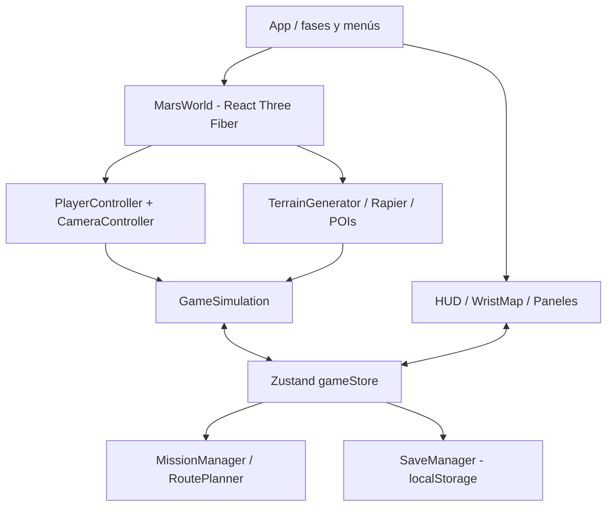

# OLYMPUS WALK 🚀

**Explore smarter. Walk safer. Discover Mars.**

**Simulador 3D de exploración científica y supervivencia operativa en Marte, desarrollado con OpenCode.** El jugador controla directamente a un astronauta sobre un terreno procedural inspirado en Olympus Mons, usa instrumentos de campo, planifica rutas y completa misiones mientras supervisa los recursos del traje y las precauciones de protección planetaria.

> **Tipo de proyecto:** videojuego web educativo / prototipo de simulación. **Datos:** el escenario, las localizaciones de campo, las condiciones ambientales y los hallazgos son simulados. No es cartografía certificada de Marte, ni un sistema de navegación real para astronautas.

## Estado de esta entrega

Este repositorio contiene el **código fuente reconstruido** del historial de una sesión real de OpenCode, más el prompt maestro, la base conceptual en PDF, documentación técnica y flujos de verificación/publicación. Se recuperaron **49 archivos** mediante las escrituras y ediciones registradas; no se inventó una cronología Git que no existía. Las dependencias declaradas se reprodujeron desde los comandos de instalación grabados en el historial.

**Verificación diferenciada:** OpenCode registró compilaciones exitosas y pruebas de navegador de su versión. En esta entrega se verificó que los 40 archivos TypeScript/TSX se pueden analizar sin errores sintácticos y pasó la comprobación estructural. La recompilación npm local está pendiente porque el entorno de empaquetado no pudo resolver `registry.npmjs.org`; ejecútala en tu equipo o revisa el resultado de GitHub Actions. Más información: [evidencia y límites](docs/implementation/08-pruebas-y-evidencia.md).

## Qué puedes hacer

| Sistema | Implementación recuperada |
|---|---|
| Exploración 3D | Terreno marciano procedural con relieve, rocas, campamento y atmósfera |
| Astronauta | Movimiento WASD, cámara tercera/primera persona, salto y físicas Rapier |
| Investigación | Escáner, análisis geológico, fotografías, muestras y observaciones |
| Navegación | Mapa de muñeca, capas, puntos de interés y A* con tres perfiles de ruta |
| Simulación | Oxígeno, batería, integridad, temperatura, comunicación e incidentes |
| Misiones | Cinco misiones con objetivos, progresión, puntuación e informe |
| Protección planetaria | Cuatro principios informativos y zonas de precaución del escenario |
| Persistencia | Progreso y configuración en `localStorage`; continuar recorrido |
| Accesibilidad básica | Controles táctiles y ajustes de calidad, volumen y HUD |

La existencia de código no sustituye una prueba funcional en el entorno final. Ver [criterios y pruebas](docs/implementation/08-pruebas-y-evidencia.md).

## Ejecutar en tu computadora

**Requisitos:** Node.js 22 o compatible, npm, navegador moderno con WebGL2 y conexión a npm para la primera instalación.

```bash
npm install
npm run dev
```

Abre **http://localhost:5173/**. Para crear un build:

```bash
npm run check:structure
npm run typecheck
npm run build
npm run preview
```

La salida web se genera en `dist/`. También existe `npm run build:singlefile` para intentar generar `OLYMPUS-WALK.html` a partir del build; este empaquetado opcional debe probarse con tu navegador.

**No se incluye `node_modules`, `dist` ni `package-lock.json` original:** el export de OpenCode no contenía estos archivos. Tras `npm install`, **conserva y sube el `package-lock.json` generado** para hacer las instalaciones posteriores reproducibles. Las versiones directas se fijaron en `package.json` desde el historial original.

## Controles

| Tecla | Acción |
|---|---|
| W A S D | Caminar y desplazarse lateralmente |
| Mouse | Mirar / rotar cámara; clic en el mundo para capturar puntero |
| Shift | Caminar deprisa |
| Espacio | Salto de apoyo en baja gravedad |
| E | Interactuar o analizar a corta distancia |
| F | Escáner científico |
| 1 / 2 / 3 | Seleccionar instrumento: escáner, analizador, cámara |
| C | Cambiar entre tercera persona y visión de casco |
| M | Abrir mapa de muñeca y planificador de ruta |
| I | Inventario |
| Tab | Objetivos |
| P | Protección planetaria |
| H | Manual de campo |
| Esc | Pausa |

También existen controles táctiles adaptados en el código.

## Las cinco misiones

1. **FIRST STEPS** — tutorial de caminata, escaneo, análisis y retorno a Base Camp A.
2. **GEOLOGICAL SURVEY** — comparar y documentar formaciones rocosas.
3. **MINERAL EXPLORATION** — identificar señales mineralógicas del escenario.
4. **TERRAIN SAFETY** — analizar obstáculos y pendientes.
5. **PLANETARY PROTECTION** — aplicar medidas de precaución y registrar decisiones.

## Arquitectura resumida



El juego es cliente web; no se recuperó un backend ni una integración activa con los endpoints de NASA. Sus referencias científicas y jurídicas se muestran como contenido informativo, mientras que el terreno y la telemetría del escenario son simulados.

## Estructura del repositorio

```text
src/                  Código del juego recuperado (React/Three/Rapier/Zustand)
docs/implementation/  Arquitectura real, historia, pruebas, trazabilidad y límites
docs/planning-original/  Documentos de planificación anteriores al código
docs/source-material/   PDF original de referencia (revisar derechos antes de publicar)
prompts/              Prompt maestro original y prompt posterior para OpenCode
scripts/              Comprobación estructural y empaquetado opcional
.github/workflows/    CI y despliegue automático a GitHub Pages
PUBLICAR.md           Guía histórica de publicación redactada por OpenCode
```

## Publicación para concurso

Puedes publicar el **juego** en GitHub Pages, Netlify o itch.io y mantener el **repositorio de desarrollo** en GitHub. Son dos resultados distintos: el repositorio sirve para revisar código y proceso; el enlace publicado sirve para jugar. Consulta [guía actualizada](docs/implementation/09-publicacion.md).

## Investigación, ética y licencias

El concepto se origina en el documento *Olympus Walk es un mapa web interactivo de una ruta a pie en Marte*. La experiencia 3D conserva el enfoque de análisis topográfico, capas y protección planetaria. [Consulta la trazabilidad](docs/implementation/11-trazabilidad.md).

- Las denominaciones NASA, USGS, COSPAR y UNOOSA hacen referencia a fuentes o marcos de consulta; el prototipo no está avalado ni certificado por ellas.
- Las áreas especiales de la demo no son delimitaciones oficiales verificadas.
- Verifica licencias y derechos del PDF antes de hacer el repositorio público.
- **Licencia del software pendiente:** consulta [LICENSE-NOTICE.md](LICENSE-NOTICE.md).

## Documentación principal

- [01 · Problema y objetivos](docs/implementation/01-problema-y-objetivos.md)
- [02 · Cómo se desarrolló](docs/implementation/02-historia-del-desarrollo.md)
- [03 · Arquitectura real](docs/implementation/03-arquitectura.md)
- [04 · Sistemas de juego](docs/implementation/04-mecanicas-y-misiones.md)
- [05 · Mundo, mapa y rutas](docs/implementation/05-mundo-mapa-rutas.md)
- [06 · Datos científicos y procedencia](docs/implementation/06-ciencia-y-procedencia.md)
- [07 · Protección planetaria](docs/implementation/07-proteccion-planetaria.md)
- [08 · Pruebas y evidencia](docs/implementation/08-pruebas-y-evidencia.md)
- [09 · Publicación](docs/implementation/09-publicacion.md)
- [10 · Assets, licencias y créditos](docs/implementation/10-assets-y-licencias.md)
- [11 · Trazabilidad](docs/implementation/11-trazabilidad.md)
- [12 · Cómo se reconstruyó el código](docs/implementation/12-metodologia-de-recuperacion.md)
- [13 · Presentación del concurso](docs/implementation/13-guion-demo.md)
- [14 · Hoja de ruta](docs/implementation/14-hoja-de-ruta.md)

---

*OLYMPUS WALK — Explore smarter. Walk safer. Discover Mars.*
