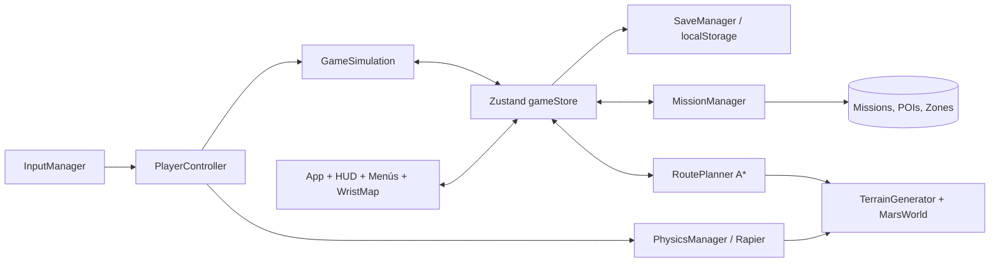

# 03 · Arquitectura técnica implementada

## Stack identificado en el historial de instalación

| Propósito | Tecnología | Versión fijada en `package.json` |
|---|---|---|
| Interfaz web | React / React DOM | 18.3.1 |
| Renderizado 3D | Three.js | 0.169.0 |
| Integración Three/React | @react-three/fiber | 8.17.10 |
| Helpers Three | @react-three/drei | 9.117.3 |
| Físicas | @dimforge/rapier3d-compat | 0.12.0 |
| Estado global | Zustand | 4.5.5 |
| Interfaz y estilos | Tailwind CSS | 3.4.17 |
| Iconos | lucide-react | 0.468.0 |
| Bundler | Vite | 5.4.11 |
| Tipado | TypeScript | 5.6.3 |

Las versiones se recuperaron de los comandos de instalación del historial, ya que el JSON no contenía un `package-lock.json` descargable.

## Flujo de datos

## Responsabilidades por módulo

### `src/app/`

`App.tsx` organiza las fases `boot`, `menu`, `mission-select`, `briefing`, `playing`, `paused` y `report`. `src/app/scene/` contiene escena, terreno, cielo, campamento, efectos, marcadores y runtime. `src/app/ui/` contiene HUD, mapa, controles táctiles, paneles y reportes.

### `src/game/player/`

`InputManager.ts` gestiona teclado, ratón y controles táctiles. `PlayerController.ts` traduce inputs en desplazamiento contextual. `AstronautRig.ts` implementa el astronauta procedural. `CameraController.ts` administra primera y tercera persona.

### `src/game/physics/`

`PhysicsManager.ts` configura Rapier, el terreno de colisión y un controlador cinemático de personaje.

### `src/game/core/`

`GameSimulation.ts` actualiza mundo/recursos/eventos. `SaveManager.ts` serializa partidas y configuración en `localStorage`. `AudioManager.ts` genera el audio. `RuntimeBridge.ts` comunica la lógica no-React con componentes de render. `FootprintEmitter.ts` emite eventos de pisadas.

### `src/game/navigation/` y `src/world/`

`RoutePlanner.ts` implementa la búsqueda de rutas sobre rejilla. `TerrainGenerator.ts` crea el campo de alturas procedural. `WorldProps.ts` mantiene elementos de entorno; `terrainData.ts` guarda el terreno de malla compartido.

### `src/game/data/` y `src/game/missions/`

Contienen el contenido de las misiones, POIs, zonas de precaución, principios científicos y cálculo de objetivos e informes de misión.

### `src/stores/`

`gameStore.ts` reúne estado y operaciones del juego: misión, HUD, recursos, telemetría, progreso, inventario, alertas, rutas y paneles. Es una pieza central y grande; su futura subdivisión se contempla en la hoja de ruta.

## Procesos y persistencia

El juego corre del lado del cliente y no requiere una base de datos ni servidor propio para su funcionamiento local. Los avances, mejores puntuaciones y ajustes se guardan en `localStorage` mediante claves versionadas `olympus-walk.*.v1`. Por tanto, el progreso es local al navegador y no se sincroniza entre dispositivos.

## Enfoque de prueba

La sesión original empleó pruebas desde una instancia Chrome automatizada mediante CDP. **Los scripts se escribieron en directorios temporales de OpenCode y no se recuperaron como parte del código fuente del juego.** Este repositorio incluye procedimientos para reproducir las comprobaciones manualmente y GitHub Actions para `typecheck` y `build`.

## Riesgos arquitectónicos

- Tamaño elevado del bundle por render 3D + motor de físicas.
- Dependencia de WebGL2 y disponibilidad de aceleración gráfica.
- `gameStore.ts` muy grande, conviene modularizar a futuro.
- Datos procedurales no sustituyen mediciones espaciales reales.
- Persistencia mediante `localStorage` expuesta a cuotas del navegador.
