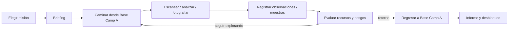

# 04 · Mecánicas, controles y misiones

## Bucle jugable

## Desplazamiento

El movimiento está implementado en `PlayerController.ts`, conectado a `InputManager.ts` y Rapier. La configuración (`src/game/config.ts`) indica velocidad de caminata 2,15 m/s, desplazamiento rápido 3,55 m/s, gravedad `-3.71`, salto de apoyo y límites configurables por pendiente. Estos parámetros son valores del videojuego y no equivalen a límites certificados de un traje espacial real.

La cámara admite una vista de tercera persona y visión de casco. El astronauta procedural se define en `AstronautRig.ts`.

## Herramientas de campo

- **Escáner (F / herramienta 1):** detecta indicadores y modifica el estado de escaneo.
- **Analizador (herramienta 2 / E cerca del objetivo):** muestra propiedades del POI seleccionado y añade observaciones.
- **Cámara (herramienta 3):** registra fotografías del juego asociadas a la posición/tiempo de la misión.
- **Muestras:** registro con identificador, POI, posición y control de capacidad de inventario.

Las operaciones están conectadas a `src/game/core/GameSimulation.ts`, `src/stores/gameStore.ts` y paneles de UI. Cada una puede estar restringida por proximidad y condiciones del escenario.

## Recursos del traje

El simulador mantiene oxígeno, batería, integridad, gestión térmica, condición física, comunicación y capacidad de inventario. Los consumos se definen en `RESOURCES` dentro de `config.ts` y se actualizan en el motor. Son **parámetros de entrenamiento** y no predicciones clínicas ni de ingeniería aeroespacial.

## Las cinco misiones incluidas en `missions.ts`

| Código | Nombre | Enfoque |
|---|---|---|
| OW-01 | FIRST STEPS | Primer recorrido, mapas, escaneo y retorno |
| OW-02 | GEOLOGICAL SURVEY | Registro geológico, muestras y fotografía |
| OW-03 | MINERAL EXPLORATION | Detección e investigación de indicadores |
| OW-04 | TERRAIN SAFETY | Desplazamiento seguro e inspección del terreno |
| OW-05 | PLANETARY PROTECTION | Precauciones, zonas y cumplimiento del protocolo educativo |

Los objetivos se encuentran como estructuras `MissionDef` en `src/game/data/missions.ts`. La progresión y evaluación se encuentran en `MissionManager.ts`, mientras que la persistencia la realiza `SaveManager.ts`.

## Menús y estados

`App.tsx` define arranque, menú, elección, briefing, juego, pausa e informe. Los paneles incluyen inventario, mapa, objetivos, protección planetaria, ajustes, ayuda y análisis. El HUD es un componente superpuesto al mundo 3D; no sustituye la vista del astronauta.

## Qué es ficticio

Los descubrimientos, misiones, muestras, consumo de traje y puntuaciones corresponden a un escenario de entrenamiento. El jugador puede aprender conceptos reales, pero no está realizando mediciones in situ sobre Marte.
